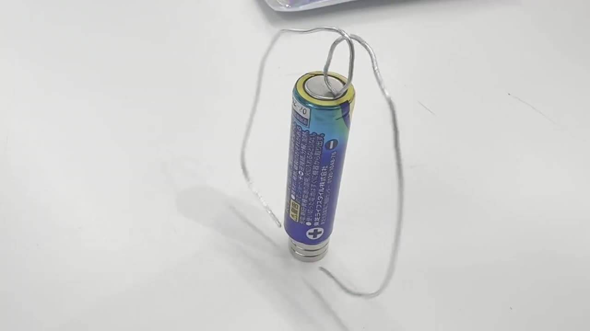
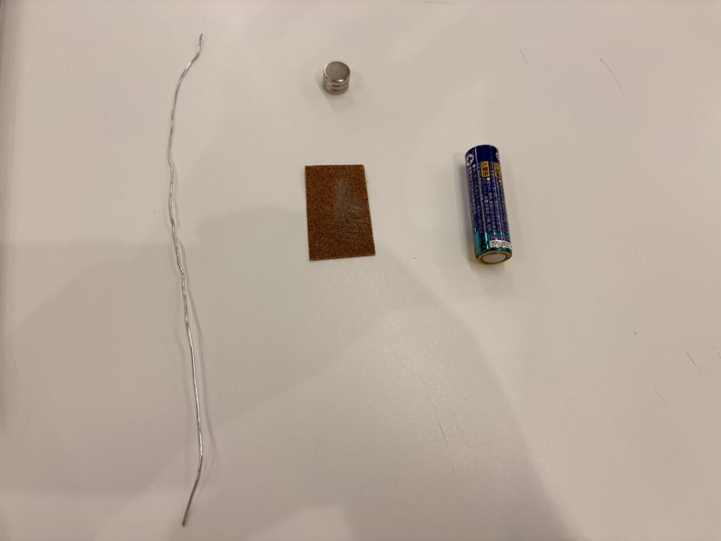
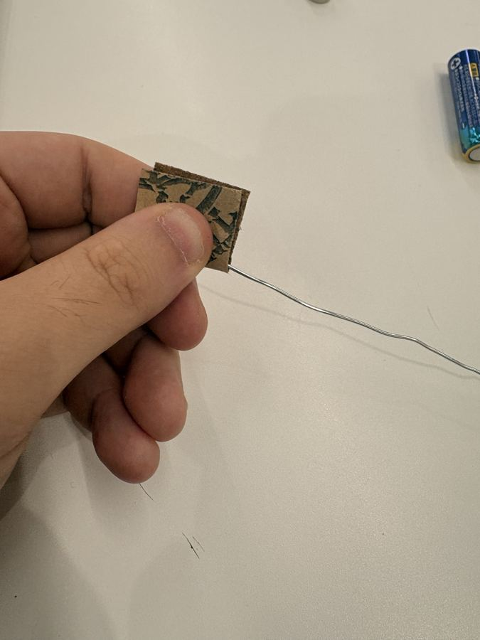
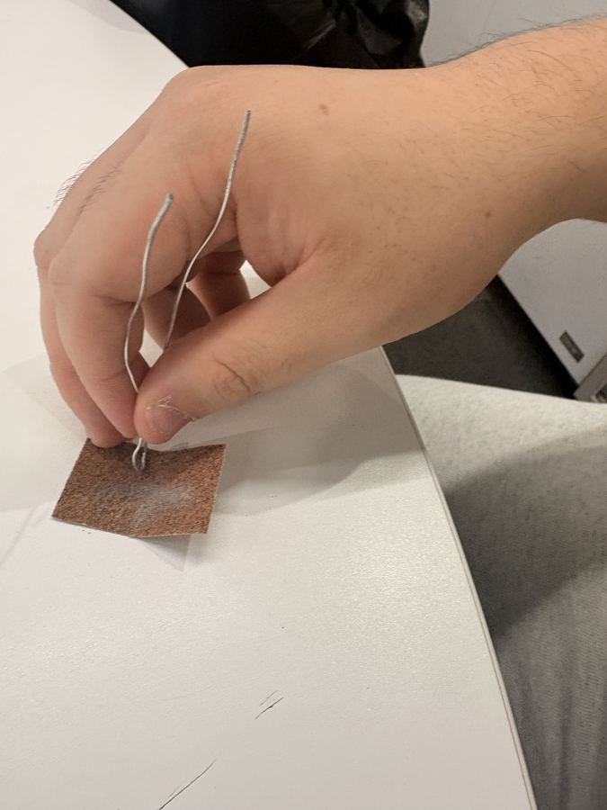
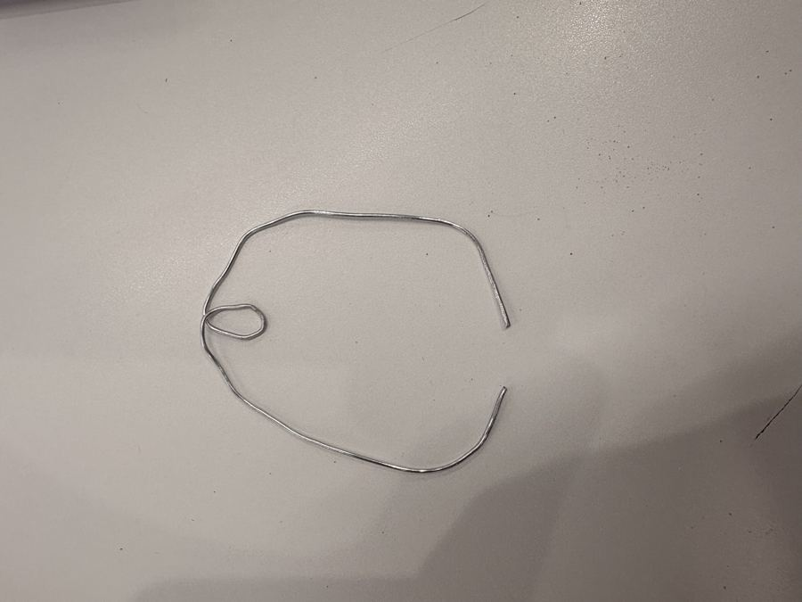
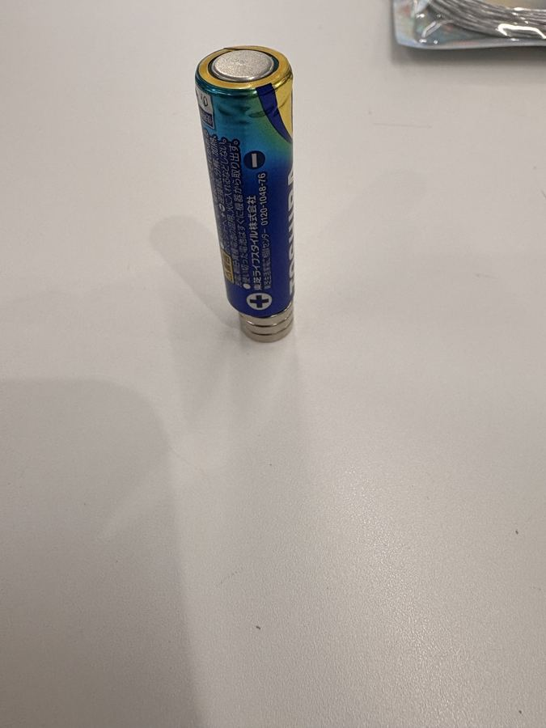

# ファラデーモーター 製作マニュアル

電池・ネオジム磁石・導線だけで回る単極モーター。製作は約10分、工具は紙やすりのみ。
30分の回の進め方は [進行台本.md](進行台本.md) を参照。

## 材料（1人分）

| 材料 | 数量 | メモ |
| --- | --- | --- |
| 単3形アルカリ乾電池 | 1本 | 新品ほどよく回る |
| ネオジム磁石（円盤形） | 3枚 | 重ねて使う。直径は電池と同程度 |
| 導線（アルミ線など） | 約20cm | 手で曲げられる太さ |
| 紙やすり | 1枚 | 2〜3人で共用可 |

## 作り方

### 1. 導線を紙やすりで磨く

紙やすりを2つ折りにして導線をはさみ、引き抜くようにこする。表面の被覆・酸化膜が残ると電気が流れない。両端と真ん中は必ず磨く。

### 2. 真ん中に小さな輪を作る

直径5mmほどの輪。電池の上の極に乗る支点になる。

### 3. 全体の形を整える

輪を上にして左右の導線を電池の両側へ回し、先端どうしを内側に向ける。先端の間隔は磁石の直径より少し狭く。左右対称に近いほど安定する。

### 4. 磁石の上に電池を立てる

### 5. 導線をのせる

輪を電池の上の極にのせ、両端を磁石の側面に軽く触れさせると回り出す。

## 回る仕組み

電流は「電池の＋極（下）→ 磁石 → 導線 → 電池の−極（上）」と流れる。導線の下部では、磁石の側面から横に広がる磁場の中を電流が上下に流れるので、両方に直角な円周方向の力（ローレンツ力 F = IL × B）を受けて回る。電池を逆さにする、または磁石を裏返すと回転が逆になる。

## うまく回らないとき

| 症状 | 原因 | 対策 |
| --- | --- | --- |
| まったく動かない | 導線が磨けていない | 輪と両端を磨き直す |
| ピクッと動いて止まる | 先端が離れる／押しつけすぎ | 磁石に軽く触れる程度に |
| 倒れる・ぶれる | 左右が非対称 | 輪を電池の中心に、左右をそろえる |
| 回りが弱い | 電池消耗・磁石不足 | 電池交換、磁石を1枚足す |

## 安全

- 実質ショート回路なので導線と電池がすぐ熱くなる。回すのは数十秒まで、測るとき以外は導線を外す
- ネオジム磁石は指をはさむ・割れる・誤飲の危険あり。子どもへの持ち帰りは導線のみ推奨
- スマホ・ICカード・時計に磁石を近づけない
- 終わったら電池と磁石を離して保管

---

`web.html` は参加者向けの1ページ版（動画・写真を埋め込み済み、単体で開ける）。
